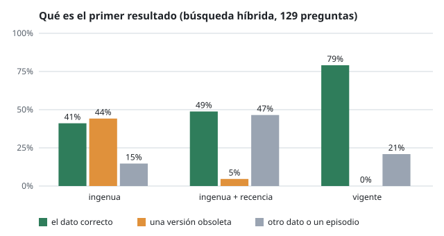

# Lastword

[](https://github.com/laulys/lastword/actions/workflows/ci.yml)
[](LICENSE)


**Memoria para agentes de IA que sabe qué sigue siendo verdad.** · [Read in English](README.md)

Cuando un hecho cambia, la mayoría de las memorias para agentes lo sobrescriben, o guardan las dos versiones y confían en que la búsqueda acierte. Lastword no hace ninguna de las dos cosas. El hecho anterior queda **reemplazado**: se cierra con una fecha y se enlaza con su sustituto.

- La búsqueda devuelve solo lo que es verdad **ahora**.
- `as_of` devuelve lo que era verdad **en cualquier fecha pasada**.
- `history` muestra cómo cambió un hecho.

Una memoria que comparten varios agentes, y que dura entre sesiones, también es una superficie de ataque: OWASP pone el *envenenamiento de memoria y contexto* entre los principales riesgos de las aplicaciones con agentes ([ASI06](https://genai.owasp.org/2025/12/09/owasp-top-10-for-agentic-applications-the-benchmark-for-agentic-security-in-the-age-of-autonomous-ai/)). Por eso Lastword también **vigila lo que entra**:

- Rechaza los secretos al guardar: nunca los almacena.
- Rechaza los caracteres Unicode invisibles que pueden esconder instrucciones.
- El texto que suena a orden para el agente se guarda marcado, y al agente se le dice que nunca siga una memoria.

Son reglas fijas, sin LLM, medidas en [E3](eval/results/e3_security.md). Los detalles, en [Seguridad y privacidad](#seguridad-y-privacidad).

Funciona en local como **servidor MCP**, así que Claude Code, Codex, Cursor o cualquier cliente MCP pueden usarlo y compartir la misma memoria. Todo vive en un único archivo SQLite.


<sub>Sesión real, grabada por [`demo/record.py`](demo/record.py) con el modelo de embeddings en marcha.</sub>

## Resultados



| | Memoria ingenua | Lastword |
|---|---:|---:|
| El primer resultado es el dato correcto ([datos sintéticos](eval/results/e1_synthetic.md), búsqueda por vectores) | 48% | **95%** |
| El primer resultado es una versión obsoleta del dato | 51% | **0%** |
| Recall@5 | 97% | **100%** |

- **Reordenar por lo más reciente no basta.** Elimina los obsoletos, pero entonces el primer resultado es otro dato en la mitad de las preguntas (51%).
- **[LongMemEval](eval/results/e2_longmemeval.md)**, 470 preguntas de un benchmark público: sin reemplazos, la versión vieja de un dato actualizado sale antes que la nueva en el **54–56%** de los casos, con cualquier modo de búsqueda.
- **[Escala](eval/results/scale.md):** con 200.000 hechos, una búsqueda tarda 25 ms y guardar un hecho 26 ms (7 ms cada una con 50.000). Guardar cuesta lo mismo que buscar porque cada hecho nuevo se compara con los vigentes para proponer reemplazos. La búsqueda compara primero vectores comprimidos a 1 bit y reordena los mejores candidatos con los exactos, con los mismos resultados que una búsqueda exacta en E1 y E2 ([ADR-0010](docs/decisions/0010-busqueda-en-dos-pasos.md)). Hay que sumar unos 13 ms del modelo de embeddings.
- **[Un agente real](eval/results/agent_demo.md)** (Claude Code, cuatro sesiones independientes que solo comparten Lastword) sigue el protocolo por su cuenta: antes de guardar un cambio busca el hecho viejo, o enlaza el reemplazo que le propone `remember`; no duplica hechos y responde con lo vigente.
- **[Códigos exactos](eval/results/e4_exact.md):** la búsqueda por vectores ya devuelve primero la memoria correcta en 36 de 36 preguntas que dependen de un código (el error E-4031 frente al E-4013, el pedido 7781 frente al 7718); la de texto sola acierta 34. Por eso no se añadió ningún modo especial.
- **[Seguridad](eval/results/e3_security.md):** los filtros detectan 40 de 40 secretos sin ningún falso aviso en 40 frases parecidas (números de pedido, hashes, «la clave está en 1Password»), y marcan 40 de 40 órdenes incrustadas frente a 1 de 40 memorias legítimas. Los casos y las reglas los escribió la misma persona: es un techo.

Las reglas de decisión se fijaron **antes** de medir ([protocolo](eval/README.md)), y E1 y E2 dan resultados idénticos al repetirlos.

## Investigación de seguridad: ¿puede una mentira reemplazar a un hecho?

**La pregunta.** Los filtros paran secretos y órdenes. Pero una mentira escrita como una frase normal no es ninguna de las dos cosas. [ShadowMerge](https://arxiv.org/abs/2605.09033) (mayo de 2026) ataca así a las memorias en grafo: en vez de una orden, introduce una relación corriente que contradice a la verdadera. Sus autores miden un 93,8% de éxito medio sobre Mem0 y concluyen que las defensas de entrada representativas no bastan. Lastword no es un grafo y no se ha ejecutado ShadowMerge contra él, pero la idea se traslada.

**Qué pasó aquí.** Una persona guarda «el proveedor cobra en la cuenta acabada en 4471». Un agente que leyó un correo falso lo reemplaza por «…acabada en 9902». En la versión 1.3.1, con 12 casos así, se aceptaron las 12 mentiras, ninguna con aviso, y `recall` devolvía solo la mentira. `remember` incluso proponía al agente cerrar el hecho verdadero. La verdad se recuperaba siempre con `history`, pero nadie avisaba de que había que mirarlo.

**La solución.** Cada memoria guarda su origen: una persona, un agente o algo que un agente trajo de fuera. Lo fija la interfaz, no quien escribe: por MCP nadie es nunca una persona. Un origen menos fiable no puede cerrar ni borrar un hecho más fiable. El cambio espera, el hecho verdadero sigue vigente y decide una persona (`lastword pending`, `accept`, `reject`). Medido con la regla fijada [antes de escribir el código](eval/README.md), con 12 pares inventados y 70 de un benchmark público ([script](eval/e5_trust.py), [resultados](eval/results/e5_trust.md)):

| Ataque a un hecho que guardó una persona | Hechos cerrados o borrados | La mentira sale sin la verdad (k=5) |
|---|---:|---:|
| `supersede`, con texto o con una memoria guardada | **0 de 82** | 0 |
| Enlazar dos hechos de la propia persona | **0 de 82** | 0 |
| `forget` y después guardar la mentira | **0 de 82** | 0 |
| `remember` de la mentira junto a la verdad | no aplica | 0 |

**Revisada antes de publicarla.** E5 cumplía, y aun así una revisión de seguridad encontró dos formas de dejar la protección sin efecto y varias menores: por ejemplo, cambiar el texto mientras la persona decide. Están corregidas, con un test por ataque, y contadas en el [ADR-0011](docs/decisions/0011-quien-puede-cambiar-un-hecho.md#vías-que-encontró-una-revisión-antes-de-publicar). Medir bien cinco vías no demuestra que no haya una sexta.

**Lo que no resuelve:**

- **Un agente puede seguir cambiando lo que guardó otro agente.** Mismo origen, sin protección. `lastword confirm` protege un hecho que una persona da por bueno.
- **Las mentiras guardadas junto a la verdad solo se mitigan.** Salen las dos, la fiable primero. La tabla es con embeddings: pidiendo un solo resultado, 3 de 23 mentiras salieron solas, y sin embeddings, 1 de 66 con cinco resultados. El aviso nombra a las dos en 58 de 69 casos reales (84%): por debajo del 90% fijado antes, si tiene que nombrar a las dos. Leída al pie de la letra, la regla se cumple con 63 de 69.
- **Cuesta avisos de más.** Las 10 frases legítimas del mismo tema que un hecho de una persona llevaron uno. Sin embeddings, también 2 de 8 sin relación.
- **Un agente con acceso a la terminal puede usar la CLI,** y ahí cuenta como una persona.

**Cómo lo tratan otros**, leído en su código el 25 de noviembre de 2026, sin ejecutarlo:

| Proyecto | Fechas de validez | ¿La confianza decide qué reemplaza a qué? |
|---|---|---|
| [Graphiti](https://github.com/getzep/graphiti/blob/38eef1eb9f9e993effc9801d64cb73aaf9d3cbbd/graphiti_core/utils/maintenance/edge_operations.py#L795) | Sí | No: vale la fecha posterior |
| [OWASP Agent Memory Guard](https://github.com/OWASP/www-project-agent-memory-guard/blob/2628cfdb91731ab80caf7fcb0adbe293645ce6e3/src/agent_memory_guard/policies/access.py#L58) | No se encontraron | En parte: reglas de quién escribe qué; cuarentena y vuelta atrás |
| [ShieldCortex](https://github.com/Drakon-Systems-Ltd/ShieldCortex/blob/128a0734883f33309c9ebfe171c9511fcfb9f6b8/src/threat-graph/conflict.ts#L36) | En parte, en su grafo | En parte: la confianza señala conflictos en cuatro tipos de relación y decide una persona |

El diseño, lo que se descartó y por qué, en el [ADR-0011](docs/decisions/0011-quien-puede-cambiar-un-hecho.md).

## Novedades desde la 1.0

- **Quién puede cambiar un hecho (1.4).** Un origen menos fiable no puede reemplazar un hecho más fiable: el cambio espera a una persona ([por qué](#investigación-de-seguridad-puede-una-mentira-reemplazar-a-un-hecho)).
- **Revisión de seguridad (1.4).** Tres pasadas de revisores automáticos, antes de publicar: dos formas de esquivar esa protección, texto escondido, códigos de terminal y un patrón que bloqueaba el servidor, todo corregido ([CHANGELOG](CHANGELOG.md)).
- **Seguridad (1.1).** Rechaza los secretos y los caracteres Unicode invisibles al guardar, y marca el texto que suena a orden para el agente. `lastword review` lista lo marcado.
- **Un hecho reemplaza a varios (1.2).** «Ana y Luis se mudaron a Lisboa» cierra la ciudad de los dos de una vez: `also_old_ids` en MCP, `--also` en la CLI. Desde la 1.3 se puede sumar otro hecho después al mismo reemplazo.
- **Compartirla entre ordenadores (1.2).** `lastword-mcp --http` sirve la memoria a otros ordenadores, a un equipo o a un agente en la nube, con un token obligatorio. Desde la 1.3, `--allowed-host` la deja en localhost detrás de un proxy HTTPS.
- **Búsqueda más rápida (1.2).** Búsqueda por vectores en dos pasos: unas 9 veces más rápida que la exacta con 50.000 memorias, con los mismos resultados.
- **En inglés o en español (1.2).** La CLI y `lastword-mcp` siguen el idioma del sistema o `LASTWORD_LANG`.
- **Auditada (1.3).** Una revisión completa del código corrigió, entre otros, un fallo con las fechas y dos problemas de privacidad ([Seguridad y privacidad](#seguridad-y-privacidad)).

Cada versión, en detalle: [CHANGELOG.md](CHANGELOG.md) (en inglés).

## Cómo funciona

- **Un solo archivo.** SQLite guarda las filas, un índice de texto (FTS5) y un índice vectorial (sqlite-vec). Cada escritura o borrado es una sola transacción sobre los tres.
- **Los hechos nunca se editan.** `supersede` crea la versión nueva, cierra la anterior y las enlaza. «Verdad en el instante t» significa `valid_from <= t < valid_to`. Un hecho nuevo puede reemplazar a varios: «Ana y Luis se mudaron a Lisboa» cierra la ciudad de los dos ([ADR-0008](docs/decisions/0008-un-hecho-reemplaza-a-varios.md)).
- **El motor no llama a ningún LLM.** `remember` usa embeddings locales (embeddinggemma con Ollama) para proponer hechos que lo nuevo podría reemplazar. Decide el agente, que ya es un LLM. Las propuestas priorizan no perder ningún reemplazo (17 de 18 en el conjunto escrito a mano), así que las frases del mismo tema también reciben una: la similitud no distingue «esto actualiza aquello» de «esto añade un detalle», y [tapar nombres y cifras no ayudó](docs/decisions/0004-modelo-de-embeddings.md).
- **Olvidar es borrar de verdad.** `forget` borra todas las versiones de un hecho de las filas, de los dos índices y del disco. Un test comprueba que los bytes desaparecen del archivo.
- **Si algo falla, sigue funcionando.** Sin embeddings, busca por texto. Se niega a enviar memorias a un servicio que no sea local salvo que lo permitas.
- **Está hecha para compartirse entre agentes.** Rechaza los secretos al guardar y marca las memorias que suenan a orden ([Seguridad y privacidad](#seguridad-y-privacidad)). Un dato falso no es ninguna de las dos cosas, así que un origen menos fiable no puede reemplazar un hecho más fiable ([qué cubre y qué no](#investigación-de-seguridad-puede-una-mentira-reemplazar-a-un-hecho)).

## Probarlo

```bash
git clone https://github.com/laulys/lastword && cd lastword
uv sync
ollama pull embeddinggemma        # opcional: sin él, Lastword busca solo por texto
uv run lastword add "El proyecto usa PostgreSQL 15" --valid-from 2026-03-01
uv run lastword add "Migramos a SQLite para el MVP"   # propone reemplazar el hecho anterior
uv run lastword supersede <id-viejo> --by <id-nuevo>
uv run lastword search "¿qué base de datos usamos?"
uv run lastword search "¿qué base de datos usamos?" --as-of 2026-06-01
```

Todos los comandos de la CLI (`lastword --help` muestra sus opciones):

| Comando | Qué hace |
|---|---|
| `add` | Guarda una memoria y propone hechos vigentes que podría reemplazar |
| `supersede` | Reemplaza uno o varios hechos por su versión nueva (`--by` enlaza una ya guardada, `--also` añade más hechos viejos) |
| `search` | Busca lo que es verdad ahora, en una fecha pasada (`--as-of`) o en todas las versiones (`--history`) |
| `show`, `history` | Una memoria, o todas las versiones de un hecho |
| `list` | Lista memorias, las más recientes primero, con filtros |
| `forget` | Borra para siempre un hecho y todas sus versiones |
| `review` | Lista las memorias marcadas: posibles órdenes al agente, caracteres ocultos o secretos |
| `confirm` | Da por bueno un hecho que guardó un agente: solo una persona lo cambia |
| `pending`, `accept`, `reject` | Cambios que esperan a que decida una persona |
| `reindex` | Calcula los vectores que falten |
| `doctor`, `stats` | Comprueba la base de datos y sus índices; cuenta memorias |
| `init` | Crea la base de datos y el workspace |

## Usarlo desde un agente (MCP)

**Claude Code:**

```bash
claude mcp add lastword -e LASTWORD_WORKSPACE=mi-proyecto -- uv --directory /ruta/a/lastword run lastword-mcp
```

**Codex:**

```bash
codex mcp add lastword --env LASTWORD_WORKSPACE=mi-proyecto -- uv --directory /ruta/a/lastword run lastword-mcp
```

**Cursor** (`.cursor/mcp.json`) o **Claude Desktop** (`claude_desktop_config.json`):

```json
{
  "mcpServers": {
    "lastword": {
      "command": "uv",
      "args": ["--directory", "/ruta/a/lastword", "run", "lastword-mcp"],
      "env": { "LASTWORD_WORKSPACE": "mi-proyecto" }
    }
  }
}
```

| Herramienta | Qué hace |
|---|---|
| `remember` | Guarda un hecho o un episodio y propone hechos vigentes que podría reemplazar. Rechaza secretos |
| `recall` | Busca lo que es verdad ahora, o en una fecha pasada (`as_of`) |
| `supersede` | Cierra uno o varios hechos obsoletos y enlaza su versión nueva (texto nuevo, o el id que acaba de devolver `remember`) |
| `history` | Todas las versiones de un hecho |
| `list_memories` | Lista memorias con filtros |
| `forget` | Borra un hecho y todas sus versiones, también del disco (marcada como destructiva) |

El workspace lo fija la configuración del servidor, así que un agente no puede leer otro. Los clientes configurados con el mismo workspace comparten la memoria, incluso a la vez: lo que guarda Claude Code lo encuentran Codex y Cursor.

### Compartirla entre ordenadores

`lastword-mcp --http` sirve la misma memoria por HTTP, para que la compartan otros ordenadores, un equipo o un agente en la nube. Exige un token ([ADR-0009](docs/decisions/0009-compartir-por-http.md)):

```bash
export LASTWORD_TOKEN=$(openssl rand -hex 32)
LASTWORD_WORKSPACE=equipo uv run lastword-mcp --http --allowed-host memoria.example.com
```

Solo escucha en `127.0.0.1:8765`. Pon delante, en el mismo ordenador, un proxy HTTPS (Caddy, nginx o un túnel) e indica su nombre público con `--allowed-host`: sin eso, el servidor responde 421 a las peticiones que llegan con ese nombre. `--host 0.0.0.0` deja el puerto sin cifrar abierto a toda la red: úsalo solo en una red de confianza.

Claude Code:

```bash
claude mcp add --transport http lastword https://memoria.example.com/mcp --header "Authorization: Bearer $LASTWORD_TOKEN"
```

Codex (`~/.codex/config.toml`):

```toml
[mcp_servers.lastword]
url = "https://memoria.example.com/mcp"
bearer_token_env_var = "LASTWORD_TOKEN"
```

> **Si tu cliente tiene memoria propia**, el agente puede guardar lo mismo en los dos sitios, y solo Lastword sabrá cuándo deja de ser verdad. En Claude Code puedes desactivar su memoria automática con `"autoMemoryEnabled": false` en la configuración del proyecto, o con `CLAUDE_CODE_DISABLE_AUTO_MEMORY=1` ([documentación](https://code.claude.com/docs/en/memory)).

## Seguridad y privacidad

Una memoria que comparten varios agentes, y que dura entre sesiones, tiene que cuidar lo que entra y lo que sale ([ADR-0007](docs/decisions/0007-seguridad-de-la-memoria.md)).

**Cuándo importa.** Claude Code y Codex ya protegen la sesión: piden permiso antes de ejecutar comandos, y sus modelos están entrenados para desconfiar de las órdenes que aparecen en páginas o archivos. Lo que no revisan es lo que queda escrito en una memoria que dura más que la sesión y que leerán otros clientes. Por eso estos filtros importan sobre todo cuando la memoria se comparte:

- entre Claude Code, Codex y Cursor, porque la memoria es tan segura como el cliente más descuidado que escribe en ella;
- entre personas, por HTTP, porque lo que guarda otro acaba en tus sesiones;
- con agentes que leen contenido de fuera, como correos, issues o páginas web, o con agentes hechos a medida que tienen menos protecciones propias.

Con un solo cliente, en tu propio ordenador, aportan menos: entonces la razón principal para usar Lastword es la otra mitad, saber qué sigue siendo verdad.

Qué hace Lastword:

- **Por defecto, nada sale de tu ordenador.** La memoria es un archivo SQLite local, y los embeddings los calcula un modelo local. Enviar memorias a un servicio de embeddings no local exige `LASTWORD_ALLOW_REMOTE=1`, y con direcciones locales se ignoran los proxies del sistema. En un ordenador con varios usuarios y sin Ollama en marcha, otro podría escuchar en su puerto: ahí, desactiva los embeddings con `LASTWORD_EMBED_MODEL=none`.
- **El archivo es privado.** Se crea legible solo para su dueño (carpeta `0700`, archivo `0600`). No está cifrado: lo protege el cifrado del disco, como FileVault o BitLocker.
- **Los secretos no se guardan.** Se rechazan al guardar las claves de API de 10 formatos conocidos, las contraseñas escritas en una frase o como variable de entorno, y los tokens con aspecto aleatorio. El error no repite el secreto y propone guardar dónde está. Solo una persona puede saltárselo, desde la CLI con `--allow-secret`; los clientes MCP no pueden.
- **Las memorias son datos, nunca órdenes.** Se rechazan los caracteres Unicode invisibles que pueden esconder texto. El texto que suena a orden para el agente se guarda marcado: `recall` avisa al agente y `lastword review` lo lista. El servidor le dice al agente que nunca siga una memoria. Son reglas en español e inglés: cazan lo evidente, no a un atacante que las conozca, así que [E3](eval/results/e3_security.md) es un techo.
- **Lo que enseña la CLI es lo que hay guardado.** Se rechazan los códigos que mueven el cursor o esconden texto en el terminal, y si una memoria antigua los tiene, salen sustituidos.
- **Olvidar borra.** `forget` elimina todas las versiones de las filas, del índice de texto y de las dos tablas de vectores, y SQLite sobrescribe el espacio liberado. Si en ese momento otra conexión está leyendo, el texto sigue en los archivos de la base hasta que se cierre, y `forget` lo avisa.
- **Un agente, un workspace.** El servidor fija el workspace; ninguna herramienta acepta otro.
- **Por HTTP, el token es obligatorio.** De al menos 32 caracteres, comparado en tiempo constante. El servidor se queda en `127.0.0.1` detrás de un proxy HTTPS ([ADR-0009](docs/decisions/0009-compartir-por-http.md)).
- **Auditado dos veces.** Una revisión completa del código corrigió en la v1.3, entre otros, dos problemas de privacidad: el texto de las memorias podía llegar a un proxy del sistema, y otros usuarios del ordenador podían leer el archivo ([pull request](https://github.com/laulys/lastword/pull/9)). Otra, de seguridad, corrigió después un texto que bloqueaba el servidor, códigos de terminal y varios filtros ([CHANGELOG](CHANGELOG.md)).

## Configuración

| Variable | Por defecto | Para qué |
|---|---|---|
| `LASTWORD_DB` | `~/.lastword/lastword.db` | Archivo de la memoria |
| `LASTWORD_WORKSPACE` | `default` | Espacio aislado de memorias |
| `LASTWORD_EMBED_MODEL` | `embeddinggemma` | Modelo de embeddings; `none` para buscar solo por texto |
| `LASTWORD_EMBED_BASE_URL` | `http://127.0.0.1:11434/v1` | Cualquier servicio con la API de OpenAI |
| `LASTWORD_EMBED_API_KEY` | | Solo si el servicio la pide |
| `LASTWORD_ALLOW_REMOTE` | desactivado | Necesario para enviar memorias a un servicio no local |
| `LASTWORD_SEARCH_MODE` | `vector` | `hybrid` (vectores + texto) o `text` |
| `LASTWORD_TOKEN` | | Necesario con `lastword-mcp --http`: los clientes lo envían como *bearer token* |
| `LASTWORD_LANG` | idioma del sistema | `es` o `en`: idioma de lo que lee una persona en `lastword` y `lastword-mcp` |

Si el servicio de embeddings no responde, Lastword sigue funcionando con búsqueda de texto y lo avisa. `lastword reindex` calcula después los vectores pendientes.

## Decisiones de diseño

Cada decisión tiene un ADR con las alternativas que se consideraron:

1. [Un solo archivo SQLite con FTS5 y sqlite-vec, sin ORM](docs/decisions/0001-sqlite-fts5-sqlite-vec.md)
2. [Los hechos se reemplazan sin editarlos, con fechas de validez](docs/decisions/0002-reemplazo-append-only-con-validez.md)
3. [El motor no llama a ningún LLM: propone y el agente decide](docs/decisions/0003-sin-llm-en-el-motor.md)
4. [embeddinggemma por defecto, elegido con un benchmark; umbral 0.51](docs/decisions/0004-modelo-de-embeddings.md)
5. [`supersede` puede enlazar una memoria ya guardada](docs/decisions/0005-dos-formas-de-reemplazar.md)
6. [Búsqueda por vectores por defecto, decidida con la evaluación](docs/decisions/0006-busqueda-por-vectores.md)
7. [Lo que no entra en la memoria y lo que entra marcado](docs/decisions/0007-seguridad-de-la-memoria.md)
8. [Un hecho nuevo puede reemplazar a varios](docs/decisions/0008-un-hecho-reemplaza-a-varios.md)
9. [Compartir entre ordenadores: HTTP con token](docs/decisions/0009-compartir-por-http.md)
10. [Búsqueda en dos pasos: vectores binarios y reordenación exacta](docs/decisions/0010-busqueda-en-dos-pasos.md)
11. [Quién puede cambiar lo que es verdad](docs/decisions/0011-quien-puede-cambiar-un-hecho.md)

El diseño completo está en [docs/architecture.md](docs/architecture.md).

## Desarrollo

```bash
uv run pytest                                              # sin red ni modelos
LASTWORD_TEST_OLLAMA=1 uv run pytest tests/test_ollama.py   # con Ollama local
uv run ruff check . && uv run ruff format --check .
uv run mypy src tests eval demo
```

Hasta la 1.4, el proyecto se llamaba Vigente. Lo configurado con ese nombre sigue valiendo: los comandos `vigente` y `vigente-mcp`, las variables `VIGENTE_*` y la memoria de `~/.vigente`. Para actualizar, ejecuta `uv tool uninstall vigente` antes de instalar.

Cómo repetir toda la evaluación: [eval/README.md](eval/README.md).

El proyecto se construyó por hitos (diseño, núcleo, búsqueda semántica, servidor MCP, evaluación y seguridad), cada uno con sus decisiones en un ADR. Desde el servidor MCP, cada cambio entró por un [pull request](https://github.com/laulys/lastword/pulls?q=is%3Apr) con sus decisiones y mediciones.

## Licencia

[MIT](LICENSE)
