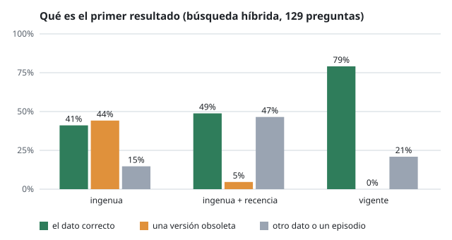

# Vigente

[](https://github.com/laulys/vigente/actions/workflows/ci.yml)
[](LICENSE)


**Memory for AI agents that knows what is still true.** · [Leer en español](README.es.md)

When a fact changes, most agent memories either overwrite it or keep both versions and hope that search picks the right one. Vigente does neither. The old fact is **superseded**: closed with a date and linked to its replacement.

- Search returns only what is true **now**.
- `as_of` returns what was true **at any past date**.
- `history` shows how a fact changed.

It runs locally as an **MCP server**, so Claude Code, Codex, Cursor or any MCP client can use it, and they can share the same memory. Everything lives in a single SQLite file.


<sub>A real session, recorded by [`demo/record.py`](demo/record.py) with the embedding model running. It is in Spanish; the CLI follows the system language, English or Spanish, or `VIGENTE_LANG`.</sub>

## Results



| | Naive memory | Vigente |
|---|---:|---:|
| First result is the right fact ([synthetic set](eval/results/e1_synthetic.md), vector search) | 48% | **95%** |
| First result is an outdated version of the fact | 51% | **0%** |
| Recall@5 | 97% | **100%** |

- **Re-ranking by recency is not enough.** It removes outdated results, but then the first result is a different fact in half of the questions (51%).
- **[LongMemEval](eval/results/e2_longmemeval.md)**, 470 questions from a public benchmark: without supersession, the old version of an updated fact ranks above the new one in **54–56%** of cases, with any search mode.
- **[Scale](eval/results/scale.md):** with 200,000 memories, a search takes 37 ms and saving a fact 4 ms (8.5 ms and 1.3 ms with 50,000). Search compares compressed 1-bit vectors first and re-ranks the best 100 with the exact ones, with the same results as an exact search in E1 and E2 ([ADR-0010](docs/decisions/0010-busqueda-en-dos-pasos.md)). Add about 15 ms for the embedding model.
- **[A real agent](eval/results/agent_demo.md)** (Claude Code, four independent sessions sharing only Vigente) follows the protocol on its own: it searches before saving, links changes without duplicating facts, and answers with what is current.
- **[Exact codes](eval/results/e4_exact.md):** vector search already returns the right memory first for 36 of 36 questions that hinge on a code (error E-4031 vs E-4013, order 7781 vs 7718); text search alone gets 34. So no special mode was added.
- **[Security](eval/results/e3_security.md):** the filters catch 40 of 40 secrets with no false alarms on 40 lookalikes (order numbers, hashes, «the key is in 1Password»), and flag 40 of 40 injected orders while marking 1 of 40 legitimate memories. The same author wrote the cases and the rules, so read it as a ceiling.

The decision rules were fixed **before** measuring ([protocol](eval/README.md)), and E1 and E2 give identical results when re-run.

## How it works

- **One file.** SQLite holds the rows, a full-text index (FTS5) and a vector index (sqlite-vec). Every write or deletion is a single transaction across all three.
- **Facts are never edited.** `supersede` creates the new version, closes the old one and links both. «True at time t» means `valid_from <= t < valid_to`. One new fact can replace several: «Ana and Luis moved to Lisbon» closes both their old cities ([ADR-0008](docs/decisions/0008-un-hecho-reemplaza-a-varios.md)).
- **The engine calls no LLM.** `remember` uses local embeddings (embeddinggemma via Ollama) to propose facts the new one may replace. The agent, which already is an LLM, decides. Proposals favour not missing a replacement (17 of 18 in the hand-written set), so statements on the same topic also get one; similarity cannot tell «this updates that» from «this adds detail», and [masking names and numbers did not help](docs/decisions/0004-modelo-de-embeddings.md).
- **Forgetting is real.** `forget` deletes every version of a fact from the rows, both indexes and the disk. A test checks that the bytes are gone from the file.
- **It degrades gracefully.** Without embeddings it searches by text. It refuses to send memories to a non-local service unless you allow it.
- **It is safe to share between agents.** Secrets are rejected on save, and so is hidden Unicode that can smuggle instructions. Text that reads like an order to the agent is stored but flagged: `recall` warns the agent, and `vigente review` lists it ([ADR-0007](docs/decisions/0007-seguridad-de-la-memoria.md)). These are rules, in Spanish and English: they catch the obvious, so the agent is also told to treat every memory as data, never as an instruction.

## Quick start

```bash
git clone https://github.com/laulys/vigente && cd vigente
uv sync
ollama pull embeddinggemma        # optional: without it, Vigente searches by text only
uv run vigente add "El proyecto usa PostgreSQL 15" --valid-from 2026-03-01
uv run vigente add "Migramos a SQLite para el MVP"   # proposes replacing the previous fact
uv run vigente supersede <old-id> --by <new-id>
uv run vigente search "¿qué base de datos usamos?"
uv run vigente search "¿qué base de datos usamos?" --as-of 2026-06-01
```

## Use it from an agent (MCP)

**Claude Code:**

```bash
claude mcp add vigente -e VIGENTE_WORKSPACE=my-project -- uv --directory /path/to/vigente run vigente-mcp
```

**Codex:**

```bash
codex mcp add vigente --env VIGENTE_WORKSPACE=my-project -- uv --directory /path/to/vigente run vigente-mcp
```

**Cursor** (`.cursor/mcp.json`) or **Claude Desktop** (`claude_desktop_config.json`):

```json
{
  "mcpServers": {
    "vigente": {
      "command": "uv",
      "args": ["--directory", "/path/to/vigente", "run", "vigente-mcp"],
      "env": { "VIGENTE_WORKSPACE": "my-project" }
    }
  }
}
```

| Tool | What it does |
|---|---|
| `remember` | Saves a fact or an episode and proposes current facts it may replace. Rejects secrets |
| `recall` | Searches what is true now, or at a past date (`as_of`) |
| `supersede` | Closes one or more outdated facts and links their new version (new text, or the id `remember` just returned) |
| `history` | All versions of a fact |
| `list_memories` | Lists memories with filters |
| `forget` | Deletes a fact and all its versions, also from disk (marked as destructive) |

The workspace is fixed by the server configuration, so an agent cannot read another one. Clients configured with the same workspace share the memory, even at the same time: what Claude Code saves, Codex and Cursor find.

### Share it between computers

`vigente-mcp --http` serves the same memory over HTTP, so other computers, a team or a cloud agent can share it. A token is required, and outside `localhost` it should sit behind HTTPS ([ADR-0009](docs/decisions/0009-compartir-por-http.md)):

```bash
export VIGENTE_TOKEN=$(openssl rand -hex 32)
VIGENTE_WORKSPACE=team uv run vigente-mcp --http --host 0.0.0.0 --port 8765
```

Claude Code:

```bash
claude mcp add --transport http vigente https://memory.example.com/mcp --header "Authorization: Bearer $VIGENTE_TOKEN"
```

Codex (`~/.codex/config.toml`):

```toml
[mcp_servers.vigente]
url = "https://memory.example.com/mcp"
bearer_token_env_var = "VIGENTE_TOKEN"
```

> **If your client has its own memory**, the agent may save the same fact in both places, and only Vigente will know when it stops being true. In Claude Code you can turn its auto memory off with `"autoMemoryEnabled": false` in the project settings, or with `CLAUDE_CODE_DISABLE_AUTO_MEMORY=1` ([docs](https://code.claude.com/docs/en/memory)).

## Configuration

| Variable | Default | Purpose |
|---|---|---|
| `VIGENTE_DB` | `~/.vigente/vigente.db` | Memory file |
| `VIGENTE_WORKSPACE` | `default` | Isolated memory space |
| `VIGENTE_EMBED_MODEL` | `embeddinggemma` | Embedding model; `none` for text-only search |
| `VIGENTE_EMBED_BASE_URL` | `http://localhost:11434/v1` | Any service with an OpenAI-compatible API |
| `VIGENTE_EMBED_API_KEY` | | Only if the service needs one |
| `VIGENTE_ALLOW_REMOTE` | off | Required to send memories to a non-local service |
| `VIGENTE_SEARCH_MODE` | `vector` | `hybrid` (vectors + text) or `text` |
| `VIGENTE_TOKEN` | | Required by `vigente-mcp --http`; clients send it as a bearer token |
| `VIGENTE_LANG` | system language | `en` or `es`: language of what people read from `vigente` and `vigente-mcp` |

If the embedding service is down, Vigente keeps working with text search and says so. `vigente reindex` fills in the missing vectors later.

## Design decisions

Each decision has an ADR with the alternatives considered (in Spanish):

1. [One SQLite file with FTS5 and sqlite-vec, no ORM](docs/decisions/0001-sqlite-fts5-sqlite-vec.md)
2. [Facts are superseded, never edited, with validity dates](docs/decisions/0002-reemplazo-append-only-con-validez.md)
3. [The engine calls no LLM: it proposes, the agent decides](docs/decisions/0003-sin-llm-en-el-motor.md)
4. [embeddinggemma by default, chosen with a benchmark; threshold 0.51](docs/decisions/0004-modelo-de-embeddings.md)
5. [`supersede` can link a memory that is already stored](docs/decisions/0005-dos-formas-de-reemplazar.md)
6. [Vector-only search by default, decided with the evaluation](docs/decisions/0006-busqueda-por-vectores.md)
7. [What never enters the memory, and what enters flagged](docs/decisions/0007-seguridad-de-la-memoria.md)
8. [One new fact can replace several](docs/decisions/0008-un-hecho-reemplaza-a-varios.md)
9. [Sharing between computers: HTTP with a token](docs/decisions/0009-compartir-por-http.md)
10. [Two-stage search: binary vectors, then an exact re-rank](docs/decisions/0010-busqueda-en-dos-pasos.md)

The full design is in [docs/architecture.md](docs/architecture.md).

## Related work

Descriptions are based on each project's own documentation (checked November 2026).

- **[Delfos](https://github.com/MiltMont/Delfos)** (Apache-2.0): graph-memory MCP server for codebases, with LLM-driven traversal of a Cue → Tag → Content graph and a C++ engine. It inspired this project. Vigente targets general facts that change over time, not code, and its engine calls no LLM.
- **[Graphiti](https://github.com/getzep/graphiti)** (Apache-2.0) and **Zep**, the commercial service built on it: temporal context graphs that invalidate outdated facts instead of deleting them, with bi-temporal edges. They use an LLM to extract entities and a graph database (Neo4j, FalkorDB or Neptune). This is the closest idea. Vigente trades the graph and the LLM for a single SQLite file and decisions made by the client agent.
- **[Mem0](https://github.com/mem0ai/mem0)** (Apache-2.0): a memory layer that uses an LLM to extract facts when adding. Since its April 2026 algorithm, extraction only adds memories, and the current state is resolved by time-aware retrieval. Vector store (Qdrant by default).
- **[Letta](https://github.com/letta-ai/letta)**, formerly MemGPT (Apache-2.0): a platform for stateful agents that edit their own memory blocks through tools, with archival memory in a vector database.
- **[MCP reference memory server](https://github.com/modelcontextprotocol/servers/tree/main/src/memory)** (MIT): a knowledge graph in a JSONL file, without versions or timestamps.
- **[LongMemEval](https://github.com/xiaowu0162/LongMemEval)** (ICLR 2025, MIT): benchmark for long-term memory in chat assistants, used here in [E2](eval/results/e2_longmemeval.md).

## Development

```bash
uv run pytest                                              # no network or models needed
VIGENTE_TEST_OLLAMA=1 uv run pytest tests/test_ollama.py   # with local Ollama
uv run ruff check . && uv run ruff format --check .
uv run mypy src tests eval demo
```

How to reproduce the whole evaluation: [eval/README.md](eval/README.md) (in Spanish, like the reports).

The project was built in milestones (design, core, semantic search, MCP server, evaluation, security), each with its decisions in an ADR. Since the MCP server, every change went through a [pull request](https://github.com/laulys/vigente/pulls?q=is%3Apr) with its decisions and measurements.

## License

[MIT](LICENSE)
