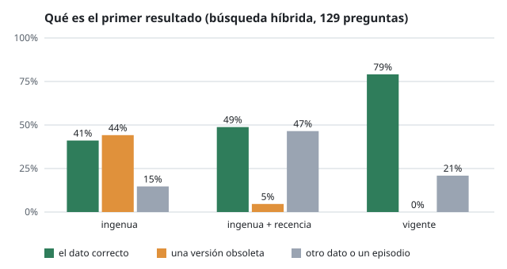

# E1. Datos sintéticos: ¿los reemplazos evitan datos obsoletos?

Generado por `eval/e1_synthetic.py`. Protocolo y reglas, fijadas antes de ejecutar, en [`eval/README.md`](../README.md).

- Fecha: 2026-11-25
- Embeddings: `embeddinggemma`
- Datos: 72 atributos, 174 versiones (102 cambios), 54 episodios de distracción, 129 preguntas (72 sobre el presente, 57 con fecha).

## Resultado

**La tesis se sostiene.** Con la búsqueda híbrida (el modo por defecto cuando se fijó el protocolo), el primer resultado es una versión obsoleta del dato en el 44% de las preguntas con la memoria ingenua y en el 0% con Lastword. Recall@5: 88% frente a 100%.

Con la búsqueda por vectores, que pasa a ser la de por defecto tras este hito ([decisiones](decisions.md)): 51% frente a 0% de obsoletas, y Recall@5 de 97% frente a 100%.

## Búsqueda híbrida (modo por defecto al fijar el protocolo)

*Obsoleta* = otra versión del mismo dato. *Ajena* = una memoria de otro dato o un episodio de distracción.

| Sistema | Preguntas | Recall@1 | Recall@5 | MRR | 1.ª obsoleta | Obsoleta en top-5 | 1.ª ajena |
|---|---|---:|---:|---:|---:|---:|---:|
| ingenua | presente (72) | 25% | 79% | 0.47 | 58% | 76% | 17% |
| ingenua | con fecha (57) | 61% | 100% | 0.77 | 26% | 32% | 12% |
| ingenua + recencia | presente (72) | 50% | 79% | 0.64 | 8% | 76% | 42% |
| ingenua + recencia | con fecha (57) | 47% | 100% | 0.66 | 0% | 32% | 53% |
| lastword | presente (72) | 75% | 100% | 0.86 | 0% | 0% | 25% |
| lastword | con fecha (57) | 84% | 100% | 0.92 | 0% | 0% | 16% |

## Modos de búsqueda (todas las preguntas)

| Sistema | Modo | Recall@1 | Recall@5 | MRR | 1.ª obsoleta |
|---|---|---:|---:|---:|---:|
| ingenua | texto | 32% | 55% | 0.44 | 33% |
| ingenua | vector | 48% | 97% | 0.69 | 51% |
| ingenua | híbrida | 41% | 88% | 0.60 | 44% |
| ingenua | híbrida ponderada | 47% | 95% | 0.66 | 47% |
| ingenua | automática | 48% | 97% | 0.69 | 51% |
| lastword | texto | 47% | 91% | 0.63 | 0% |
| lastword | vector | 95% | 100% | 0.97 | 0% |
| lastword | híbrida | 79% | 100% | 0.88 | 0% |
| lastword | híbrida ponderada | 91% | 100% | 0.95 | 0% |
| lastword | automática | 95% | 100% | 0.97 | 0% |

## Umbral de posibles reemplazos

Se registraron los 3 candidatos de cada uno de los 174 hechos durante la ingesta (102 reemplazan a otro). Criterio fijado de antemano: mejor F2 en E1, validado con el conjunto escrito a mano del hito 2.

| Umbral | E1: precisión | E1: recall | E1: F1 | E1: F2 | Validación: precisión | Validación: recall | Validación: F2 |
|---:|---:|---:|---:|---:|---:|---:|---:|
| 0.51 (actual) | 22% | 99% | 0.36 | 0.58 | 63% | 94% | 0.86 |
| 0.68 | 50% | 80% | 0.61 | 0.72 | 75% | 50% | 0.54 |
| 0.70 | 59% | 78% | 0.67 | 0.74 | 80% | 44% | 0.49 |
| 0.71 (mejor F2 en E1, mejor F1 en E1) | 68% | 76% | 0.72 | 0.75 | 80% | 44% | 0.49 |
| 0.72 | 69% | 70% | 0.69 | 0.69 | 89% | 44% | 0.49 |
| 0.74 | 73% | 60% | 0.66 | 0.62 | 88% | 39% | 0.44 |

**Decisión según la regla:** se mantiene 0.51 (F2 en validación: 0.49 con 0.71 frente a 0.86 con 0.51).

Aviso: las frases de E1 salen de plantillas, así que se parecen más entre sí que las reales. Por eso el umbral se valida con datos escritos a mano y distintos.
