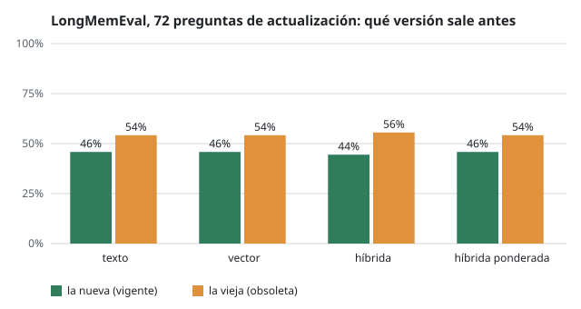

# E2. LongMemEval: búsqueda sobre conversaciones reales

Generado por `eval/e2_longmemeval.py` sobre `longmemeval_s_cleaned.json` (licencia MIT, [LongMemEval](https://github.com/xiaowu0162/LongMemEval)). Protocolo en [`eval/README.md`](../README.md).

- Fecha: 2026-11-18
- Embeddings: `embeddinggemma`
- 470 preguntas (sin las de abstención), 114894 mensajes de usuario guardados como episodios (429 recortados a 4000 caracteres). Tiempo total: 0 min.
- Se responde después de todo el historial, como pide LongMemEval: en 69 preguntas hay sesiones fechadas (menos de 24 h) después de la pregunta, y buscar en su fecha exacta ocultaría esa evidencia con el filtro temporal.
- Métricas por sesión: una sesión cuenta como encontrada si aparece alguno de sus mensajes. Solo se indexan mensajes del usuario: en *single-session-assistant* la evidencia está en las respuestas del asistente.

## Modos de búsqueda

| Modo | Recall@5 (any) | Recall@5 (all) | MRR |
|---|---:|---:|---:|
| texto | 95% | 81% | 0.88 |
| vector | 99% | 94% | 0.96 |
| híbrida | 97% | 89% | 0.95 |
| híbrida ponderada | 97% | 89% | 0.95 |

## Por tipo de pregunta (Recall@5 any)

| Tipo | n | texto | vector | híbrida | híbrida ponderada |
|---|---:|---:|---:|---:|---:|
| knowledge-update | 72 | 100% | 100% | 100% | 100% |
| multi-session | 121 | 94% | 99% | 98% | 98% |
| single-session-assistant | 56 | 95% | 95% | 95% | 95% |
| single-session-preference | 30 | 77% | 100% | 90% | 90% |
| single-session-user | 64 | 100% | 100% | 100% | 100% |
| temporal-reasoning | 127 | 94% | 99% | 96% | 96% |

## Actualizaciones: ¿qué versión aparece antes?

En las 72 preguntas de *knowledge-update* el historial contiene la versión vieja del dato y la nueva, en sesiones distintas. Ninguna búsqueda sabe cuál está vigente: es el problema que resuelven los reemplazos, que aquí no hay, porque los mensajes se guardan tal cual.

| Modo | la nueva delante | la vieja delante | solo la nueva | solo la vieja | ninguna |
|---|---:|---:|---:|---:|---:|
| texto | 46% | 54% | 0% | 0% | 0% |
| vector | 46% | 54% | 0% | 0% | 0% |
| híbrida | 44% | 56% | 0% | 0% | 0% |
| híbrida ponderada | 46% | 54% | 0% | 0% | 0% |
