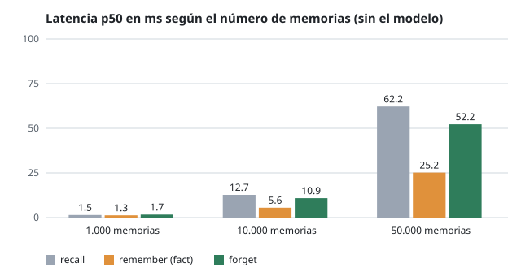

# Latencia y escala

Generado por `eval/scale.py`. Vectores aleatorios de 768 dimensiones (las de embeddinggemma): mide el coste de Vigente sin el del modelo de embeddings.

- Fecha: 2026-11-18
- Máquina: arm64, Darwin 25.5.0, Python 3.12.16
- Repeticiones por tamaño: 50 búsquedas, 30 escrituras de hechos (con detección de posibles reemplazos), 10 borrados.

| Memorias | recall p50 / p95 | remember p50 / p95 | forget p50 / p95 | Carga por memoria | Tamaño en disco |
|---:|---:|---:|---:|---:|---:|
| 1.000 | 1.5 / 1.5 ms | 1.3 / 2.2 ms | 1.7 / 15.1 ms | 0.51 ms | 7 MB |
| 10.000 | 12.7 / 13.0 ms | 5.6 / 5.9 ms | 10.9 / 12.0 ms | 0.52 ms | 39 MB |
| 50.000 | 62.2 / 66.6 ms | 25.2 / 26.9 ms | 52.2 / 57.5 ms | 0.55 ms | 191 MB |

A esto hay que sumar el modelo de embeddings: una consulta con embeddinggemma en Ollama tarda unos 15 ms (p50, [elección del modelo](embedding_choice.md)), y en lote procesa unos 65 textos por segundo en esta máquina.
